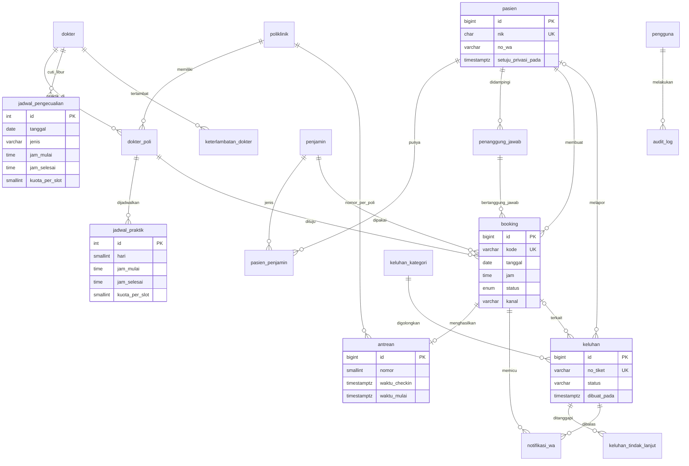

# ERD – RSIA Pasutri Bogor

Render dengan editor yang mendukung Mermaid (GitHub, VS Code + ekstensi Mermaid).

## Keputusan desain

| Masalah di website | Keputusan database |
|---|---|
| Hari "tidak tersedia" baru diketahui setelah pasien memilih | `jadwal_praktik` per dokter per hari; UI hanya menawarkan slot yang ada. Cuti lewat `jadwal_pengecualian`. |
| Booking ganda dan slot penuh | Indeks unik parsial `uq_booking_aktif` + trigger `cek_kuota_slot` dengan advisory lock (aman saat dua pasien klik bersamaan). |
| Jadwal bentrok dua sesi dokter | `EXCLUDE USING gist` pada `jadwal_praktik`. Bentrok dihitung hanya bila rentang `berlaku_dari`–`berlaku_sampai` juga bertemu, sehingga jadwal baru bisa menggantikan jadwal lama tanpa menghapus riwayat. |
| Libur, jam berubah, dan praktik tambahan pada satu tanggal | `jadwal_pengecualian` dengan jenis `LIBUR`, `UBAH_JAM`, dan `TAMBAHAN`. Trigger `cek_kuota_slot` membaca ketiganya. `UBAH_JAM` dan `TAMBAHAN` menggantikan jam rutin dan wajib mengisi `kuota_per_slot`; satu tanggal hanya boleh punya satu pengecualian jam. |
| Slot tidak punya ukuran, jam booking bebas | Slot dimulai pada `jam_mulai` praktik dan berulang setiap `poliklinik.durasi_menit`. Trigger menolak jam yang tidak kelipatan durasi dan slot yang selesai lewat jam tutup. Jadwal rutin juga dicocokkan dengan `poli_id` booking. |
| Booking dibatalkan lalu diaktifkan lagi melewati kuota | Trigger `trg_kuota_aktifkan` memeriksa kuota saat status kembali dari `BATAL`. |
| Data dokter tidak konsisten ("Sp.A" vs "Sp. A.") | Nama, `gelar_depan`, `gelar_belakang` dipisah; `jenis_tenaga` membedakan dokter, dokter gigi, terapis. |
| Penjamin hanya pilihan tanpa detail | `penjamin` (master) + `pasien_penjamin` (no. kartu) + `booking.no_rujukan`. |
| NIK/HP tanpa validasi | `CHECK` regex di level database, bukan hanya di form. |
| Nomor antrean terlewat, tidak jelas siapa memanggil siapa | Status `DILEWATI` dan `jumlah_dilewati` (1x boleh dipanggil ulang, 2x menjadi tidak hadir). View `v_antrean_berikutnya` menetapkan urutan per dokter (jam booking, lalu nomor). Panggilan di luar urutan wajib beralasan dan masuk `audit_log`. |
| Antrean terasa sangat lama karena dokter terlambat tanpa kabar | Tabel `keterlambatan_dokter`: memicu WhatsApp ke seluruh pasien dokter itu, menggeser estimasi, dan menjadi data untuk dashboard manajemen. |
| Keluhan tanpa tindak lanjut | `keluhan` + `keluhan_tindak_lanjut` + `keluhan_kategori.sla_jam`; view `v_keluhan_sla`. |
| Manajemen tanpa data | View `v_kpi_harian` menghitung no-show, waktu tunggu, kanal dari `booking` dan `antrean`. |
| Data pribadi sensitif | `setuju_privasi_pada` (bukti persetujuan UU PDP) dan `audit_log` untuk akses/ubah data. |

## Batasan

- Rekam medis, farmasi, dan billing tidak masuk cakupan; tetap di SIMRS.
- Skema belum diuji pada PostgreSQL sungguhan (belum ada instance di komputer ini). Jalankan `psql -f schema.sql` pada database kosong untuk memeriksanya.
