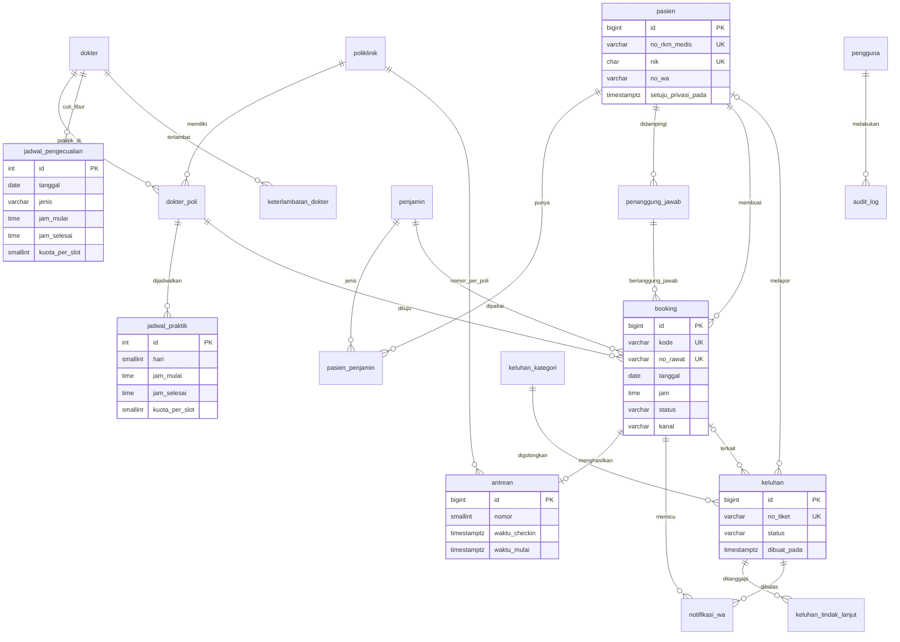

# ERD – RSIA Pasutri Bogor

Render dengan editor yang mendukung Mermaid (GitHub, VS Code + ekstensi Mermaid).

## Keputusan desain

| Masalah di website | Keputusan database |
|---|---|
| Hari "tidak tersedia" baru diketahui setelah pasien memilih | `jadwal_praktik` per dokter per hari; UI hanya menawarkan slot yang ada. Cuti lewat `jadwal_pengecualian`. |
| Booking ganda | Indeks unik parsial `uq_booking_aktif` mencegah satu pasien punya dua booking aktif pada dokter dan hari yang sama. |
| Slot penuh saat dua pasien klik bersamaan | Tidak dijaga database. Aplikasi harus mengunci baris atau penghitung (mis. `SELECT ... FOR UPDATE`) sebelum menyimpan booking. |
| Jadwal bentrok dua sesi dokter | `UNIQUE (dokter_id, hari, jam_mulai, berlaku_dari)` pada `jadwal_praktik` mencegah jadwal kembar. Pengecekan rentang jam yang bertemu dilakukan aplikasi, karena `EXCLUDE` sudah dihapus. |
| Libur, jam berubah, dan praktik tambahan pada satu tanggal | `jadwal_pengecualian` dengan jenis `LIBUR`, `UBAH_JAM`, dan `TAMBAHAN`. Aplikasi membaca ketiganya. `UBAH_JAM` dan `TAMBAHAN` menggantikan jam rutin dan wajib mengisi `kuota_per_slot`; satu tanggal hanya boleh punya satu pengecualian jam. |
| Slot tidak punya ukuran, jam booking bebas | Slot dimulai pada `jam_mulai` praktik dan berulang setiap `poliklinik.durasi_menit`. Aplikasi menolak jam yang tidak kelipatan durasi dan slot yang selesai lewat jam tutup. Aplikasi juga mencocokkan jadwal rutin dengan `poli_id` booking. |
| Booking dibatalkan lalu diaktifkan lagi melewati kuota | Aplikasi memeriksa kuota saat status kembali dari `BATAL`. |
| Data dokter tidak konsisten ("Sp.A" vs "Sp. A.") | Nama, `gelar_depan`, `gelar_belakang` dipisah; `jenis_tenaga` membedakan dokter, dokter gigi, terapis. |
| Penjamin hanya pilihan tanpa detail | `penjamin` (master) + `pasien_penjamin` (no. kartu) + `booking.no_rujukan`. |
| NIK/HP tanpa validasi | `CHECK` regex di level database, bukan hanya di form. |
| Nomor antrean terlewat, tidak jelas siapa memanggil siapa | Status `DILEWATI` dan `jumlah_dilewati` (1x boleh dipanggil ulang, 2x menjadi tidak hadir). Urutan per dokter (jam booking, lalu nomor) dihitung aplikasi. Panggilan di luar urutan wajib beralasan dan masuk `audit_log`. |
| Antrean terasa sangat lama karena dokter terlambat tanpa kabar | Tabel `keterlambatan_dokter`: memicu WhatsApp ke seluruh pasien dokter itu, menggeser estimasi, dan menjadi data untuk dashboard manajemen. |
| Keluhan tanpa tindak lanjut | `keluhan` + `keluhan_tindak_lanjut` + `keluhan_kategori.sla_jam`. Status SLA dihitung aplikasi. |
| Manajemen tanpa data | Aplikasi menghitung no-show, waktu tunggu, dan kanal dari `booking` dan `antrean`. |
| Data pribadi sensitif | `setuju_privasi_pada` (bukti persetujuan UU PDP) dan `audit_log` untuk akses/ubah data. |

## Batasan

- Rekam medis, farmasi, dan billing tidak masuk cakupan; tetap di SIMRS.
- Skema ditujukan untuk PostgreSQL 9.5 atau lebih baru. Skema sudah diubah agar sesuai 9.5, tetapi belum dijalankan di server 9.5. Semua objek ada di schema `rsia`.
- Skema hanya berisi tabel, PK, FK, UNIQUE, CHECK, dan index. Tidak ada trigger, fungsi, view, atau extension. Aturan yang dulu dijaga database sekarang dijaga aplikasi (lihat tabel keputusan).
- Skema versi lama sudah dijalankan di PostgreSQL 18.6 (container Docker lokal, database `simrs_dev`) tanpa error. Database yang berisi skema lama tidak dibersihkan otomatis.
- Migrasi `migrasi-kunci-khanza.sql` diuji 2026-10-28 di PostgreSQL 18.6 dengan skema lama. Belum diuji setelah perubahan ini.
- Untuk memeriksa skema baru, jalankan `psql -v ON_ERROR_STOP=1 -f schema.sql` pada database kosong.
